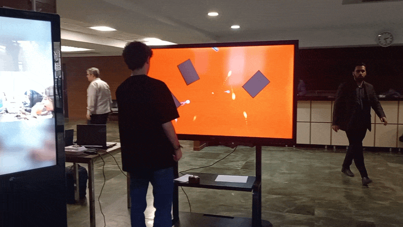
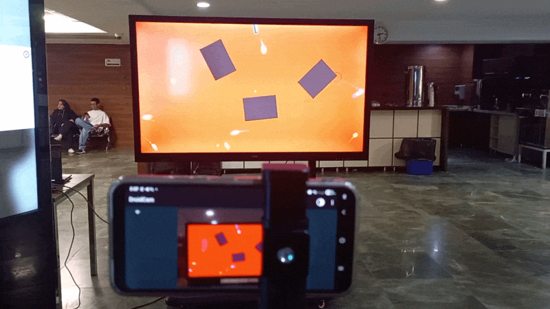
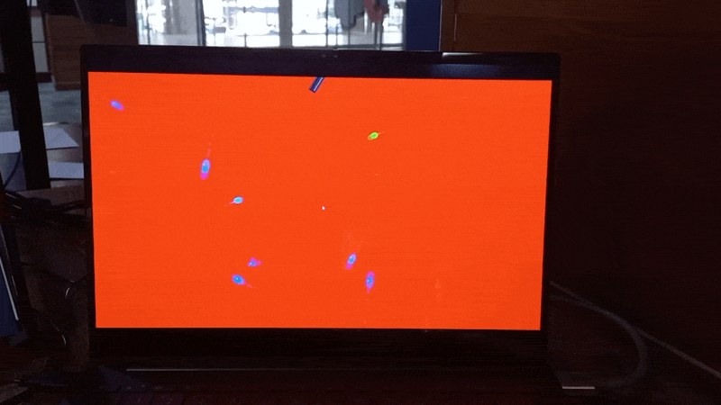
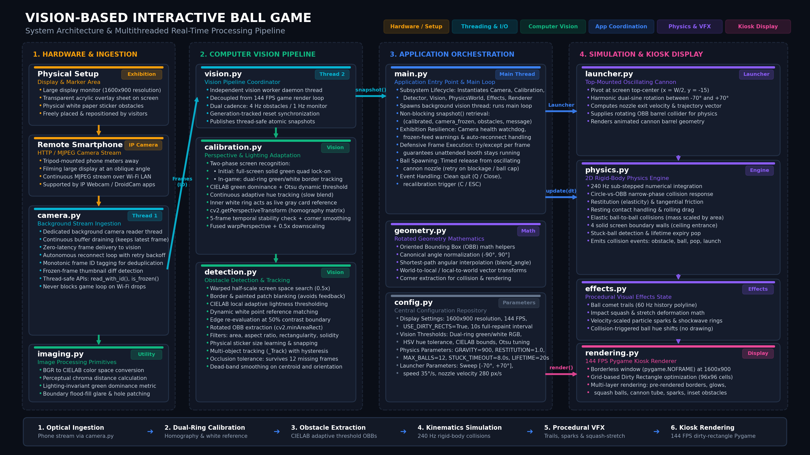
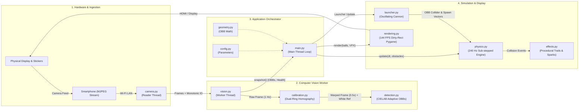

# Vision-Based Interactive Ball Game

[](https://www.python.org/)
[](https://opencv.org/)
[](https://www.pygame.org/)
[](https://numpy.org/)

An interactive physical-to-virtual installation connecting real-world objects with a 2D physics simulation in real time. Developed for a university Open Day exhibition, this system allows visitors to place physical markers on a transparent surface mounted over a display monitor. An external camera continuously tracks these markers, dynamically generating matching virtual obstacles that deflect balls launched across the screen.

---

## Table of Contents

- [Project Overview](#project-overview)
- [Demonstrations & Media](#demonstrations--media)
- [Key Features](#key-features)
- [System Architecture](#system-architecture)
- [Technical Pipeline & Implementation](#technical-pipeline--implementation)
- [Physical & Hardware Setup](#physical--hardware-setup)
- [Technologies & Libraries](#technologies--libraries)
- [Project Structure](#project-structure)
- [Installation & Setup](#installation--setup)
- [Execution & Usage](#execution--usage)
- [Configuration Reference](#configuration-reference)

---

## Project Overview

The project creates an engaging physical computing exhibit for exhibition attendees. Rather than interacting via conventional controllers, visitors place physical rectangular white paper markers anywhere on a transparent acrylic sheet affixed to the front of a large monitor.

```text
[ Physical World ]                                       [ Digital Simulation ]
Visitors place physical stickers on screen  ──►  Camera captures scene  ──►  Homography & CIELAB Vision
                                                                                     │
Display shows real-time bouncing physics   ◄──  144 FPS Kiosk Renderer  ◄──  240 Hz Rigid-Body Engine
```

A remote smartphone camera placed several meters away observes the monitor at an oblique angle and streams video over a local Wi-Fi network. The host machine ingests this stream, computes an adaptive homography transformation to correct perspective distortion, extracts each sticker's position and orientation as an Oriented Bounding Box (OBB), and integrates them as solid physical colliders into a real-time rigid-body simulation.

---

## Demonstrations & Media

### 1. Main Demo Video (Exhibition Event)
*Footage of placing physical markers on the large exhibition monitor during the live university event, demonstrating virtual balls colliding and bouncing elastically off the physical stickers.*



---

### 2. Camera Streaming Demonstration
*A recording of a smartphone screen displaying the live camera feed. The smartphone is positioned several meters away and captures the exhibition monitor. Its live video stream is transmitted to the laptop, where the computer vision system processes the incoming frames.*



---

### 3. Laptop Gameplay Video
*Direct screen recording of the game application running natively on the host laptop, illustrating the 144 FPS rendering, rotating launcher cannon, particle effects, and collision mechanics.*



---

## Key Features

- **Asynchronous Multithreaded Architecture**: Three decoupled threads prevent network and computer vision workloads from stalling the 144 FPS game loop:
  1. *Camera Reader Thread* (`camera.py`): Continuous stream draining, buffer elimination, automatic network reconnection, and frozen-frame detection.
  2. *Vision Pipeline Thread* (`vision.py`): Coordinates homography updates (1 Hz) and sticker extraction (4 Hz) on downscaled frames.
  3. *Main Thread* (`main.py` & `rendering.py`): Drives 240 Hz sub-stepped physics simulation and 144 FPS Pygame kiosk rendering.
- **Two-Phase Screen Recognition & Calibration**:
  - *Uncalibrated Phase*: Paints the screen solid green to detect the initial monitor quad without visual ambiguity.
  - *In-Game Phase*: Displays a concentric dual-ring border (40px green outer ring, 26px white inner ring) around the display edge. This preserves tracking throughout gameplay while leaving the center open for physics.
- **Lighting-Invariant Vision (CIELAB & Dynamic White Reference)**:
  - Operates in CIELAB color space where lightness ($L^*$) is decoupled from chromaticity ($a^*, b^*$).
  - Per-frame Otsu thresholding on green dominance adapts dynamically to ambient hall lighting shifts.
  - The white inner border ring acts as an on-screen "gray card", continuously updating the camera's true white point to prevent false sticker rejections.
- **Rotated Oriented Bounding Box (OBB) Detection**:
  - Uses `cv2.minAreaRect` to track obstacles at arbitrary angles with canonical angle normalization ($(-90^\circ, 90^\circ]$).
  - Half-contrast edge refinement ensures identical physical sticker sizes regardless of shadows or spotlights.
  - Rejects false positives (circular glows, hands, glare) using aspect ratio, rectangularity, and solidity metrics.
- **Physical Sticker Size Learning & Temporal Tracking**:
  - Automatically clusters and learns sticker dimensions, snapping detected boxes to expected sizes and accepting edge-to-edge merged stickers.
  - Hysteresis tracking (`_Track`) requires 2 consecutive detections to confirm new stickers and survives temporary occlusions (up to 12 missing frames / 3 seconds).
- **2D Rigid-Body Physics with Oscillating Launcher**:
  - Top-mounted oscillating cannon barrel swings smoothly across $[-70^\circ, +70^\circ]$ via a dual-sine harmonic function, launching balls outward.
  - Narrow-phase circle-vs-OBB collision handling in local rotated coordinates.
  - Supports configurable elasticity (restitution), surface friction, rolling drag, and ball-to-ball momentum exchange.
  - Solid screen boundaries on all four edges, ball stuck detection, and lifetime timeouts.
- **Grid-Based Dirty Rectangle Rendering**:
  - Slices the 1600x900 viewport into 96x96 pixel cells, updating only actively modified cells to drastically reduce CPU/GPU blitting load.
  - Camera-safe visual styling (saturated hues, dim additive halos) ensures procedural effects never trigger computer vision false positives.
- **Exhibition Fault Tolerance**:
  - Background camera loop auto-reconnects with exponential backoff on stream interruptions.
  - Mean-absolute-difference thumbnail analysis identifies frozen video feeds.
  - Defensive per-frame exception wrappers ensure the unattended booth application never crashes.

---

## System Architecture

The following diagram illustrates the complete 4-tier pipeline, threading model, and inter-module communication flow:



### End-to-End Execution Flow



---

## Technical Pipeline & Implementation

### 1. Optical Ingestion & Camera Watchdog (`camera.py`)
- Reads an HTTP/MJPEG stream (e.g., `http://172.30.1.216:4747/video`) via `cv2.VideoCapture`.
- Runs on a dedicated daemon thread that continually consumes frames and overwrites an internal slot with only the single most recent frame (`read_with_id()`), bypassing OS/driver socket buffer latency.
- Periodically resizes incoming frames to a $32 \times 18$ grayscale thumbnail to compute mean absolute pixel difference. If delta falls below `CAMERA_FROZEN_DIFF_THRESHOLD` (0.6) for longer than `CAMERA_FROZEN_SECONDS` (2.0s), the stream is flagged as frozen.

### 2. Perspective Calibration & Homography (`calibration.py`, `imaging.py`)
- Computes a $3 \times 3$ perspective transformation matrix mapping skewed camera coordinates to screen pixels ($1600 \times 900$).
- Evaluates green dominance using CIELAB's $a^*$ channel ($128 - a^*$) and computes dynamic per-frame split points using Otsu's thresholding.
- Continually learns the camera's observed white point by sampling the inner white border ring, yielding a dynamic reference $(a^*, b^*)$ for color-neutrality checks.
- Applies 5-frame temporal stability filtering and exponential corner smoothing ($\alpha = 0.25$) to prevent transform jitter.

### 3. Rotated Obstacle Detection & Tracking (`detection.py`, `geometry.py`)
- Warps the camera frame at half scale (`DETECTION_SCALE = 0.5`) to accelerate processing.
- Uses `cv2.adaptiveThreshold` on CIELAB lightness ($L^*$) against a neighborhood sized to sticker dimensions, making segmentation resilient to shadows and non-uniform illumination.
- Re-evaluates each candidate's contour boundary at the 50% contrast line between sticker lightness and background screen level, standardizing measured dimensions under spotlights or shadows.
- Fits oriented bounding boxes via `cv2.minAreaRect`, normalizes orientations into canonical $(-90^\circ, 90^\circ]$, and tracks stickers across frames with centroid proximity matching (`OBSTACLE_TEMPORAL_MATCH_DISTANCE = 80px`).
- Retains established tracks for up to 12 frames without detection, allowing hands to temporarily pass in front of markers without dropping obstacles.

### 4. 2D Kinematics Simulation (`physics.py`, `launcher.py`, `geometry.py`)
- Fixed numerical sub-stepping (`PHYSICS_MAX_STEP_SECONDS = 1/240 s`) eliminates tunneling artifacts for high-speed balls.
- Rotates ball coordinates into the obstacle's local frame via `world_to_local` to evaluate circle-vs-box clamping, returning surface normals, penetration depth, and contact points.
- Applies momentum exchange for ball-to-ball collisions, mass-scaled by ball area ($r^2$).
- The rotating launcher tube at top-center ($x = 800, y = -15$) acts both as an animated emitter and as an OBB collider.
- Balls that stay within 30 pixels of their position for 8 seconds (`BALL_STUCK_TIMEOUT_SECONDS`) or exceed 20 seconds of lifetime (`BALL_MAX_LIFETIME_SECONDS`) are purged with a pop event.

### 5. Procedural VFX & High-Performance Rendering (`rendering.py`, `effects.py`)
- Implements a **Dirty Rectangle Grid** of $96 \times 96$ pixel cells. Only cells containing balls, particles, or modified obstacles are repainted and refreshed via `pygame.display.update(dirty_rects)`.
- Pre-renders the calibration border and background once onto a dedicated off-screen surface.
- Procedural cosmetic layer: 60 Hz comet motion trails, directional squash-and-stretch polygon deformation along impact normals, velocity-scaled spark particles, and shockwave rings.
- Obstacle visualization on screen is drawn inset (`DETECTED_OBSTACLE_PAINT_INSET_RATIO = 0.22`) and blanked out in the detector mask to prevent recursive detection feedback loops.

---

## Challenges & Solutions

### Background Reflection and False Detections

During initial testing, the game used a black background. However, reflections from ambient light on the display surface created bright regions that the vision system sometimes misclassified as white markers. This resulted in false detections and affected the reliability of the tracking pipeline.

We identified this issue during the event preparation and switched the background from black to red. The red background reduced the visual interference caused by reflections, making the white markers easier to distinguish and improving detection reliability.

---

## Physical & Hardware Setup

| Component | Specification / Details |
| :--- | :--- |
| **Main Display** | Large exhibition monitor or TV running at $1600 \times 900$ (kiosk borderless mode). |
| **Interaction Surface** | Transparent acrylic sheet mounted flush over the display glass. |
| **Obstacles** | Rectangular white paper stickers placed onto the acrylic surface. |
| **Capture Device** | Smartphone mounted on a tripod 2–4 meters away, angled obliquely toward the screen. |
| **Streaming Protocol** | HTTP / MJPEG stream over local Wi-Fi (IP Webcam / DroidCam). |
| **Host Machine** | Laptop or PC running Python 3 with the display output connected to the monitor. |

---

## Technologies & Libraries

- **Language**: Python 3
- **Computer Vision**: OpenCV (`opencv-python`)
  - Image transformations, perspective warping (`warpPerspective`, `getPerspectiveTransform`).
  - Color space conversions (BGR to CIELAB and HSV).
  - Contour analysis, morphological operations, and minimum area rectangle fitting (`minAreaRect`).
  - Adaptive thresholding and boundary flood filling.
- **Display & Rendering**: Pygame
  - Borderless window management, dirty-rectangle grid rendering, double buffering, hardware clock timing.
- **Mathematics & Data Handling**: NumPy
  - Multi-dimensional matrix manipulation, array vectorization, perspective transformations.

---

## Project Structure

```text
vision-based-interactive-ball-game/
├── assets/
│   ├── architecture/
│   │   └── system-architecture.png   # System architecture diagram
│   ├── demo/                         # Demonstration recordings & GIFs
│   │   ├── video1.mp4
│   │   ├── video2.mp4
│   │   └── video3.mp4
│   └── images/                       # Photography & test figures
│       └── image1.jpg
├── calibration.py                    # Perspective homography & dual-ring screen tracking
├── camera.py                         # Threaded HTTP stream ingestion & freeze detection
├── config.py                         # Centralized parameters, thresholds, and dimensions
├── detection.py                      # CIELAB adaptive thresholding & OBB obstacle tracking
├── effects.py                        # Procedural VFX (trails, squash-stretch, sparks, rings)
├── geometry.py                       # Rotated OBB math, angle normalization, local/world transforms
├── imaging.py                        # Shared CIELAB conversions, chroma distance, flood fill
├── launcher.py                       # Oscillating top cannon barrel & spawn velocity kinematics
├── main.py                           # Application entry point, main loop, and threading supervisor
├── physics.py                        # 240 Hz sub-stepped 2D rigid-body collision simulation
├── rendering.py                      # 144 FPS Pygame renderer with 96x96 dirty-rectangle grid
├── vision.py                         # Asynchronous vision coordinator thread
├── requirements.txt                  # Python package dependencies
├── .gitignore                        # Git exclusion rules
└── README.md                         # Project documentation
```

---

## Installation & Setup

### 1. Clone the Repository
```bash
git clone https://github.com/RezaAdousi/vision-based-interactive-ball-game.git
cd vision-based-interactive-ball-game
```

### 2. Create and Activate a Virtual Environment
```bash
# Windows (PowerShell)
python -m venv .venv
.venv\Scripts\Activate.ps1

# Linux / macOS
python3 -m venv .venv
source .venv/bin/activate
```

### 3. Install Dependencies
```bash
pip install -r requirements.txt
```

---

## Execution & Usage

### 1. Configure the Camera Stream URL
Open `config.py` and set `CAMERA_URL` to the IP/port exposed by your streaming app (e.g., IP Webcam or DroidCam on the smartphone):
```python
CAMERA_URL = "http://192.168.1.100:8080/video"
```

### 2. Launch the Application
```bash
python main.py
```

### 3. Calibration Workflow
1. When launched, the application opens a borderless $1600 \times 900$ window.
2. If uncalibrated, the screen turns solid green. Ensure the smartphone camera has an unobstructed view of the monitor.
3. Once the system detects 5 stable consecutive frames of the screen quad, calibration locks automatically.
4. The display transitions to game mode, drawing the dual-ring border (outer green, inner white) and beginning ball launches from the oscillating cannon.

### 4. Interactive Keyboard Controls
| Key | Action |
| :--- | :--- |
| `C` or `ESC` | Reset calibration (forces homography re-acquisition and clears active physics objects). |
| `Q` | Graceful shutdown (terminates background threads and releases video streams). |

---

## Configuration Reference

Key parameters defined in `config.py`:

| Parameter | Default | Description |
| :--- | :--- | :--- |
| `SCREEN_WIDTH`, `SCREEN_HEIGHT` | `1600`, `900` | Target display resolution in screen pixels. |
| `TARGET_FPS` | `144` | Pygame target display frame rate. |
| `USE_DIRTY_RECTS` | `True` | Enables 96x96 grid dirty-rectangle optimization. |
| `PHYSICS_MAX_STEP_SECONDS` | `1 / 240.0` | Maximum numerical integration slice to prevent tunneling. |
| `BALL_GRAVITY` | `900` | Downward gravitational acceleration ($px/s^2$). |
| `BALL_RESTITUTION` | `1.0` | Coefficient of restitution ($1.0 = \text{elastic}$). |
| `BALL_SPAWN_INTERVAL_SECONDS` | `2.5` | Cadence for dropping new balls from the cannon. |
| `MAX_SIMULTANEOUS_BALLS` | `12` | Upper limit on concurrent balls in the arena. |
| `BALL_STUCK_TIMEOUT_SECONDS` | `8.0` | Time a ball can remain motionless before popping. |
| `BALL_MAX_LIFETIME_SECONDS` | `20.0` | Maximum survival duration for any single ball. |
| `OBSTACLE_DETECTION_INTERVAL` | `0.25` | Obstacle detection rate on vision thread (4 Hz). |
| `MONITOR_DETECTION_INTERVAL` | `1.0` | Calibration verification rate on vision thread (1 Hz). |
| `DETECTION_SCALE` | `0.5` | Downscale factor for perspective-warped obstacle image. |
